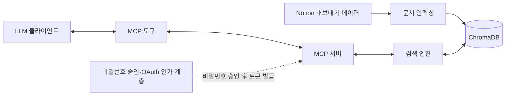
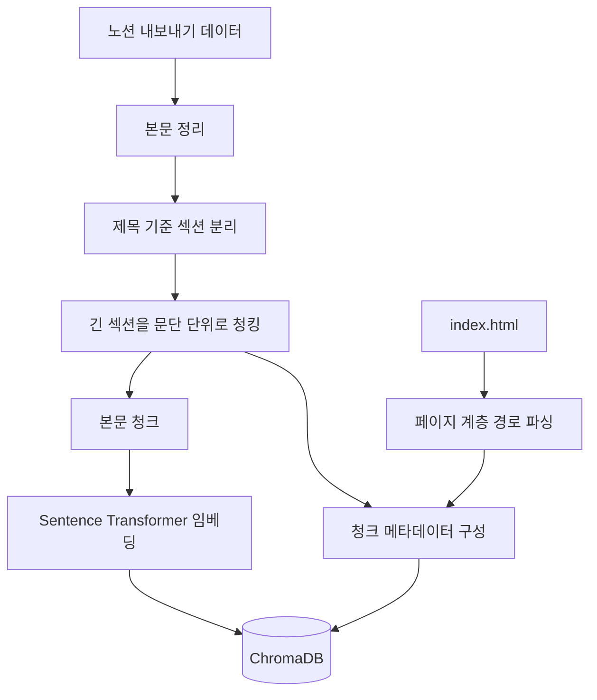
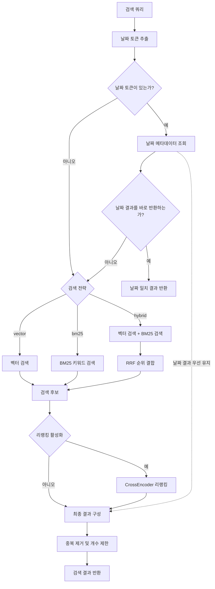
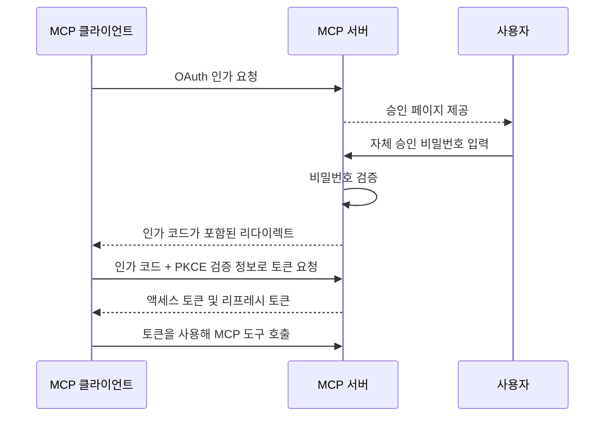

## 프로젝트 개요

Notion 내보내기 데이터를 로컬 지식 베이스로 구성하고, 벡터 검색과 키워드 검색을 결합해 관련 맥락을 LLM 클라이언트에 제공하는 RAG 시스템입니다. 검색 및 메타데이터 조회 기능을 MCP 도구로 제공해, LLM이 개인화된 응답을 생성하는 데 활용할 수 있습니다.

## 주요 기능

- **문서 인덱싱** — Notion 내보내기 데이터를 섹션·문단 단위로 청킹하고 페이지 계층 정보를 함께 저장.
- **하이브리드 검색** — ChromaDB의 벡터 검색과 직접 구현한 BM25 키워드 검색을 RRF로 결합.
- **검색 결과 리랭킹** — CrossEncoder로 검색 후보의 쿼리 관련도를 다시 평가.
- **메타데이터 조회** — 페이지 경로·날짜·계층 깊이 등을 조건으로 필터링·정렬하고 메타데이터 고유값 조회.
- **MCP 인터페이스** — 검색과 메타데이터 조회를 별도 도구로 제공.
- **비밀번호 기반 접근 제어** — Claude 웹 커넥터에 자체 비밀번호 확인 절차를 연결하기 위해 OAuth 인증 흐름을 활용.

## 개발 배경

**2026년 3월**에 Notion AI를 무료 체험으로 사용하면서 상당히 개인화된 응답을 제공하는 것을 발견했습니다. 물론 노션에는 그동안 작성했던 일기와 에세이가 전부 들어있었지만, ChatGPT에도 그에 못지않은 내용이 채팅 메시지로 입력되어 있었습니다. 하지만 ChatGPT는 Notion AI만큼 개인화된 응답을 하지 못했습니다. 이때 'Notion AI를 결제해야겠다'가 아니라 '어떻게 하면 이렇게 할 수 있을까?'를 고민하다가 지식베이스와 채팅 기록의 차이를 알게 되었고, 직접 RAG 시스템을 만들기 시작했습니다.

처음에는 ChromaDB의 벡터 검색만을 사용하는 구조로 만들어봤지만 기대에 미치지 못했습니다. 검색 품질을 개선하기 위해 BM25를 직접 구현해 벡터 검색과 결합하고, RRF 순위 결합과 CrossEncoder 리랭킹을 추가했습니다. 이후 날짜와 페이지 계층 정보를 메타데이터로 활용해, 의미적 유사도뿐 아니라 기록의 시점과 원본 문서의 구조도 검색에 반영하도록 발전시켰습니다.

## 시스템 구성

시스템은 문서를 검색 가능한 형태로 만드는 인덱싱 경로와, LLM 클라이언트의 검색 요청을 처리하는 경로로 나뉩니다. MCP 서버는 검색 엔진을 도구로 노출하며, 접근 제어 계층은 자체 비밀번호 승인 결과를 OAuth 토큰 기반의 후속 요청 인증으로 연결합니다.

## 문서 인덱싱

인덱싱 단계에서는 본문 청크와 페이지 구조 메타데이터를 함께 구성합니다. 아래는 두 정보가 결합되어 검색 가능한 데이터로 저장되는 흐름을 보여줍니다.

`embed.py`는 노션 내보내기 데이터를 정리한 뒤 제목을 기준으로 섹션을 나누고, 긴 섹션은 문단 단위로 분할합니다. 각 청크에 해당 섹션의 제목을 다시 연결해 일부 문맥이 분할 과정에서 사라지는 것을 줄였습니다. 노션 내보내기 데이터에 포함된 `index.html`에서 페이지 계층 경로를 읽어 청크와 연결하고, 원본 파일명·페이지 제목·경로·상위 경로·계층 깊이·제목·날짜 등의 메타데이터를 함께 저장합니다.

청크 임베딩에는 `jhgan/ko-sroberta-multitask` 모델을 사용하고, 본문·벡터·메타데이터를 ChromaDB에 저장합니다. 본문의 의미적 유사도뿐 아니라 페이지 계층과 날짜 등의 메타데이터도 검색에 활용할 수 있도록 구성했습니다.

## 검색 엔진

검색 엔진은 쿼리 성격에 따라 벡터 검색, 키워드 검색 또는 하이브리드 검색을 수행합니다. 날짜가 포함된 쿼리는 날짜 메타데이터를 먼저 활용하고, 필요에 따라 검색 후보를 CrossEncoder로 리랭킹합니다.

### 검색 파이프라인

날짜 토큰이 포함된 질의는 날짜 메타데이터를 먼저 조회합니다. 순수 날짜 질의는 일치 결과가 있으면 바로 반환합니다. 그 외에는 날짜 일치 결과만으로 요청 개수를 충족하면 바로 반환하고, 부족한 경우 일반 검색 결과와 결합한 뒤에 중복 청크를 제거합니다.

### 벡터 검색과 키워드 검색

벡터 검색은 `jhgan/ko-sroberta-multitask` 모델로 질의와 문서 청크를 임베딩하고, ChromaDB에서 의미적으로 가까운 내용을 검색합니다.

키워드 검색은 `notion_store.py`의 `BM25Index` 클래스로 직접 구현했습니다. 토큰화와 용어·문서 빈도, 역문서 빈도, 문서 길이 정규화를 이용해 순위를 계산하며, 본문뿐 아니라 파일명·페이지 제목·경로·상위 경로·날짜도 검색 대상으로 활용합니다.

### 하이브리드 검색과 RRF

벡터 검색과 BM25는 점수 체계가 다르므로 원점수를 직접 합치지 않고, 각 검색 결과 목록의 순위를 RRF로 결합해 후보 목록을 구성합니다.

### CrossEncoder 기반 리랭킹

`bce-reranker-base_v1` CrossEncoder로 질의와 후보 문서의 관련도를 다시 평가해 순위를 조정합니다. 리랭킹 여부는 검색 옵션으로 선택할 수 있게 제공됩니다.

## MCP 인터페이스

검색 로직은 `notion_store.py`에 두고 `mcp_server.py`에서 MCP 도구로 노출해 검색 엔진과 클라이언트 연결 계층을 분리합니다.

| 도구              | 역할                                |
| --------------- | --------------------------------- |
| `search_notion` | 벡터·BM25·하이브리드 검색으로 관련 문서 탐색       |
| `query_notion`  | 메타데이터 조건과 정렬·고유값 조회를 이용한 구조 기반 탐색 |

## 접근 제어 구현

### Claude 웹 커넥터 연동과 인증 문제 해결

자체 비밀번호 승인 기능을 구현한 뒤에 테스트하는 과정에서 Claude 웹 커넥터가 이것을 인증 방식으로 처리하지 못한다는 사실을 발견했습니다. 서버에서 비밀번호를 검증하는 것만으로는 연결을 완료하거나 후속 MCP 요청의 인증으로 이어갈 수 없었습니다.

비밀번호 절차를 없애면 별도 인증 없이 연결할 수 있었지만, 인증을 유지하기 위해 Claude 웹 커넥터가 지원하는 OAuth 인가 흐름에 자체 비밀번호 검증을 통합했습니다. 비밀번호 검증에 성공하면 인가 코드를 발급하고, 클라이언트가 이를 토큰으로 교환해 이후 MCP 요청에 사용하도록 구성했습니다.

### 승인 및 토큰 흐름

## 기술 스택

### 외부 라이브러리 및 모델

| 기술                            | 종류     | 활용                          |
| ----------------------------- | ------ | --------------------------- |
| ChromaDB                      | 라이브러리  | 임베딩 벡터와 문서 메타데이터 저장         |
| Sentence Transformers         | 라이브러리  | 문장 임베딩 및 CrossEncoder 모델 실행 |
| `jhgan/ko-sroberta-multitask` | 임베딩 모델 | 문서 청크와 검색 쿼리의 임베딩           |
| `bce-reranker-base_v1`        | 리랭킹 모델 | 쿼리와 검색 후보의 관련도 평가           |
| MCP Python SDK                | 라이브러리  | MCP 서버와 도구 인터페이스            |
| Starlette                     | 라이브러리  | HTTP 요청·응답 및 인증 경로 처리       |
| Pydantic                      | 라이브러리  | 인증 관련 데이터 모델 검증             |

### 직접 구현한 구성 요소

| 구성 요소                | 구현 범위                                    |
| -------------------- | ---------------------------------------- |
| `embed.py`           | Notion 문서 정리·청킹, 페이지 계층 정보 연결, 임베딩 및 인덱싱 |
| `BM25Index` 클래스 (`notion_store.py`) | 토큰화와 문서 통계를 이용한 BM25 점수 계산               |
| `NotionStore` 클래스 (`notion_store.py`) | 벡터·BM25·하이브리드 검색, RRF 결합, 리랭킹, 메타데이터 조회  |
| `mcp_server.py`      | 검색·조회 도구 노출 및 HTTP 기반 MCP 연결             |
| `LocalOAuthProvider` 클래스 (`oauth_provider.py`) | 자체 비밀번호 승인과 OAuth 인가 코드·토큰 발급 흐름 연결      |